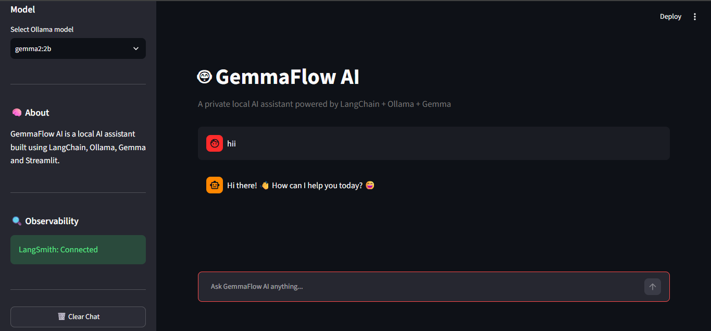

# 🤖 GemmaFlow AI

A private, local AI chatbot interface built using **Streamlit**, **LangChain**, **Ollama**, and **Gemma**. GemmaFlow AI lets you interact with open-weight Gemma models locally with integrated observability through **LangSmith**.

---

## 🚀 Live Demo

[](YOUR_STREAMLIT_DEPLOYMENT_URL_HERE)

> **Note:** Replace `YOUR_STREAMLIT_DEPLOYMENT_URL_HERE` with your actual Streamlit deployment link.

---

## 📷 Interface Preview



---

## ✨ Key Features

- **Local Inference:** Powered by Ollama running Google's Gemma models (`gemma:2b`, `gemma2:2b`).
- **Interactive Chat Interface:** Clean UI rendered using Streamlit chat components.
- **Observability Integration:** Built-in tracing with LangSmith via `.env` configuration.
- **Dynamic Model Selection:** Switch models on the fly from the sidebar.
- **Session Management:** Clear chat history with a single click.

---

## 🛠️ Tech Stack

- **Frontend / Framework:** Streamlit
- **LLM Orchestration:** LangChain Core (`ChatPromptTemplate`, `StrOutputParser`)
- **Model Server:** Ollama (`langchain_community.llms.Ollama`)
- **Observability:** LangSmith
- **Environment Management:** `python-dotenv`

---

## 📂 Project Structure

```text
├── app.py              # Main Streamlit application
├── requirements.txt    # Project dependencies
├── README.md           # Project documentation
